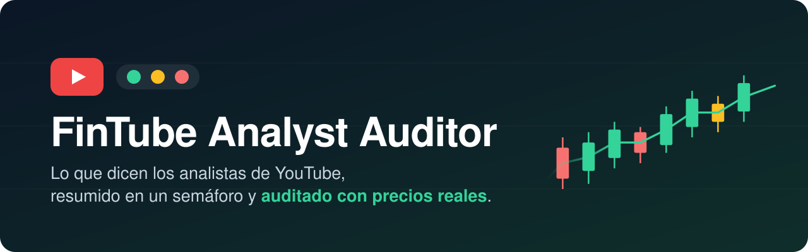

<div align="center">



<br>

**Pregúntale a tu asistente de IA qué recomienda un analista de bolsa en YouTube,<br>sin ver el vídeo entero, y comprueba si acertó.**

<br>

[](CHANGELOG.md)
[](LICENSE)
[](https://agentskills.io)
[](#-requisitos)


[**Instalar**](#-instalación) · [**Qué hace**](#-qué-hace) · [**Ejemplos**](#-ejemplos-de-preguntas) · [**Analistas**](#-analistas-que-ya-conoce) · [**Preguntas frecuentes**](#-lo-que-conviene-saber)

</div>

<br>

> [!WARNING]
> **No es asesoramiento financiero.** La skill resume opiniones de terceros y las compara con precios históricos. Las decisiones de inversión son tuyas.

<br>

## ✨ Qué hace

Una *skill* es un "superpoder" que instalas en tu asistente de IA. Esta le enseña a hacer tres cosas:

<table>
<tr>
<td width="33%" align="center" valign="top">

### 📺
**Ve el vídeo por ti**

Descarga los subtítulos y separa el análisis de bolsa de la tertulia y la autopromoción.

</td>
<td width="33%" align="center" valign="top">

### 🚦
**Te da un semáforo**

Comprar, mantener o vender, con precios de entrada, stop y el minuto exacto del vídeo.

</td>
<td width="33%" align="center" valign="top">

### 📊
**Comprueba si acertó**

Compara cada recomendación con precios reales de Yahoo Finance y con el IBEX 35.

</td>
</tr>
</table>

Además **guarda un historial de cada señal**: sabe cuándo apareció por primera vez, te enseña cada vez que el analista movió un soporte o un stop y calcula su tabla de aciertos frente al IBEX 35.

Y si le cuentas qué acciones tienes, **te avisa cuando un analista cambia de opinión sobre ellas.**

<br>

## 💬 Ejemplos de preguntas

> 🗣️ *"Resúmeme este vídeo y dime qué recomienda comprar: https://youtu.be/..."*
>
> 🗣️ *"¿Qué ha dicho últimamente Alberto Iturralde?"*
>
> 🗣️ *"En septiembre dijeron que vendiera Santander. ¿Acertaron?"*
>
> 🗣️ *"Tengo 500 acciones de Repsol. ¿Algún analista ha cambiado de opinión?"*
>
> 🗣️ *"¿Han movido el soporte de Santander? ¿Qué tasa de acierto tiene Especulación en Bolsa?"*

**Así responde:**

| Semáforo | Activo | Ticker | Entrada | Stop | Caducidad | Momento del vídeo |
| :-- | :-- | :-- | --: | --: | :-- | :-- |
| 🟢 **COMPRAR** | Banco Santander | `SAN.MC` | 10,20 € | 9,80 € | 29-nov | ▶️ 00:14:32 |
| 🟡 **MANTENER** | Iberdrola | `IBE.MC` | — | — | — | ▶️ 00:21:05 |
| 🔴 **VENDER** | Solaria | `SLR.MC` | — | — | — | ▶️ 00:03:10 |

> ⏱️ **Análisis de mercado: 18 de 52 minutos (35 %).** El resto, tertulia política y autopromoción.

<br>

## 📺 Analistas que ya conoce

La skill viene con estos canales comprobados, así que basta con decir el nombre:

| Analista | Dónde | Cuándo |
| :-- | :-- | :-- |
| **Alberto Iturralde y Miguel Méndez** | [Especulación en Bolsa](https://www.youtube.com/@especulacionenbolsa) | Cada día laborable. Mercado general, índices, oro, plata, petróleo, bitcoin y los mismos valores españoles con soportes y resistencias actualizados a diario. |
| **Alberto Iturralde** | [Capital Radio](https://www.youtube.com/channel/UCmU9b04Ym19_OvsSdt7rRYg) | Lunes 18:00 (*Mercado Abierto*), viernes 09:30 (*Capital, la Bolsa y la Vida*) y *Clase Magistral* con Laura Blanco los viernes. |
| **Miguel Méndez** | *Capital Intereconomía* | Miércoles de 11:00 a 12:00. Pásale el enlace del vídeo a tu asistente. |

> [!TIP]
> Como en Especulación en Bolsa repasan los mismos valores cada día, puedes preguntar *"¿qué ha cambiado respecto a ayer?"* y la skill te dirá solo qué soportes o recomendaciones se han movido.

¿Sigues a otro analista? Pásale a tu asistente el enlace de su canal. Y si quieres que lo incluyamos para todos, [abre una propuesta](https://github.com/jmorenobl/fintube-analyst-auditor/issues).

<br>

## 📥 Instalación

### ¿Funciona en mi app?

La skill está hecha y probada para **Claude**. Necesita **ejecutar un pequeño programa** en tu ordenador que descarga los subtítulos de YouTube y los precios de Yahoo Finance, y no todas las apps pueden hacerlo, aunque te dejen instalar la skill:

| App | ¿Funciona? | Ve a… |
| :-- | :-- | :-- |
| **Claude, app de escritorio** (Mac y Windows) | ✅ **Sí, completa.** Se instala con doble clic, sin Python ni terminal. | [Opción 1](#opcion-1) ⭐ |
| **Claude Code** | ✅ **Sí, completa.** | [Opción 2](#opcion-2) ⭐⭐ |
| **Claude en la web** (claude.ai) | ⚠️ **Con límites.** YouTube suele bloquear los subtítulos desde la nube y el historial se pierde al cerrar el chat. | [Opción 3](#opcion-3) ⭐⭐ |
| ChatGPT, Gemini, Codex, Cursor y otras | No son compatibles oficialmente. Algunas funcionan y otras no. | [Otras apps](#otras-apps) |

> [!WARNING]
> Si tu asistente contesta **sin** decirte que ha descargado la transcripción, desconfía de los minutos y los niveles que te dé: probablemente tu app no puede ejecutar la skill. Mira [Algo no funciona](#-algo-no-funciona).

<br>

<a id="opcion-1"></a>
### 1️⃣ Claude, app de escritorio &nbsp;<sub>⭐ la más fácil</sub>

Se instala como una **extensión**: un archivo que abres con doble clic. Trae el programa y las instrucciones, y todo se ejecuta en tu ordenador.

| Paso | Qué hacer |
| :-: | :-- |
| **1** | Instala la [app de escritorio de Claude](https://claude.ai/download) si no la tienes. |
| **2** | Descarga **`fintube-analyst-auditor.mcpb`** desde la [página de versiones](https://github.com/jmorenobl/fintube-analyst-auditor/releases/latest). |
| **3** | Ábrelo con doble clic. Se abrirá Claude: pulsa **Instalar**. |
| **4** | Abre un chat nuevo y pregunta, por ejemplo: *"Resúmeme este vídeo y dime qué recomienda comprar: https://youtu.be/..."* |

> [!TIP]
> La primera vez tarda un minuto: la extensión descarga lo que necesita. Después va rápido.

> [!NOTE]
> No hace falta subir el ZIP de la skill ni activar la ejecución de código: la extensión ya trae las instrucciones. Si el doble clic no funciona, en Claude ve a **Configuración → Extensiones** y arrastra ahí el archivo. Los nombres de los menús cambian a menudo; si no los encuentras, pregúntale a Claude: *"¿Cómo instalo una extensión .mcpb?"*

<br>

<a id="opcion-2"></a>
### 2️⃣ Claude Code

Instálala como plugin (con actualizaciones):

```text
/plugin marketplace add jmorenobl/fintube-analyst-auditor
/plugin install fintube-analyst-auditor@fintube
```

O pídeselo a Claude Code con este mensaje:

```text
Instala la skill de https://github.com/jmorenobl/fintube-analyst-auditor
para que esté disponible en todos mis proyectos. Comprueba también que
tengo Python 3 y uv, y si no, explícame en lenguaje sencillo cómo
instalarlos. Al terminar, dime cómo usarla.
```

<br>

<a id="opcion-3"></a>
### 3️⃣ Claude en la web &nbsp;<sub>claude.ai</sub>

| Paso | Qué hacer |
| :-: | :-- |
| **1** | Descarga **`fintube-analyst-auditor.zip`** desde la [página de versiones](https://github.com/jmorenobl/fintube-analyst-auditor/releases/latest). **No lo descomprimas.** |
| **2** | En Claude, ve a **Configuración → Capacidades** y activa **Ejecución de código y creación de archivos**. |
| **3** | En esa misma sección, añade estos dominios a la lista de permitidos:<br>`youtube.com` · `www.youtube.com` · `finance.yahoo.com` · `query1.finance.yahoo.com` · `query2.finance.yahoo.com` |
| **4** | Ve a **Personalizar → Skills**, pulsa **+ Crear skill → Subir una skill** y elige el ZIP. |

> [!IMPORTANT]
> Sin el paso 3 la skill no puede descargar ni vídeos ni precios. Aun así, YouTube bloquea a menudo las descargas desde la nube: si usas Claude a menudo, la [app de escritorio](#opcion-1) funciona mejor.

<br>

<a id="otras-apps"></a>
### Otras apps

No las probamos con cada versión, así que no te garantizamos que funcionen. Esto es lo que puedes hacer en cada caso:

**Asistentes que trabajan en tu ordenador** (Codex, Gemini CLI, Antigravity, Cursor, Windsurf, OpenCode, Copilot): suelen funcionar, porque pueden ejecutar el programa. Pídele a tu asistente que la instale con este mensaje:

```text
Instala la skill de https://github.com/jmorenobl/fintube-analyst-auditor
para que esté disponible en todos mis proyectos. Si tengo Node.js, usa
"npx skills add jmorenobl/fintube-analyst-auditor -g". Si no, descarga la
carpeta skills/fintube-analyst-auditor en tu carpeta global de skills.
Comprueba también que tengo Python 3 y uv, y si no, explícame en
lenguaje sencillo cómo instalarlos. Al terminar, dime cómo usarla.
```

**ChatGPT** (planes Business, Enterprise y Edu): puedes subir el ZIP en **Skills → Crear → Subir desde tu ordenador**. Tiene los mismos límites que Claude en la web: YouTube suele bloquear las descargas y el historial se pierde.

**Gemini (web o app) y ChatGPT sin skills**: no pueden ejecutar el programa, así que no tienen los subtítulos reales, ni precios, ni historial. Gemini te deja subir la skill, pero solo lee las instrucciones y puede darte minutos y cifras aproximados o inventados. Lo que sí puedes hacer es darle tú la transcripción:

1. En YouTube, debajo del vídeo, pulsa **Más → Mostrar transcripción**.
2. Selecciona todo el texto de la transcripción, cópialo y pégalo en el chat con un mensaje como:

```text
Esta es la transcripción de un vídeo de bolsa. Separa el análisis de
mercado de la tertulia y dame una tabla con cada valor que recomienda
comprar, mantener o vender, con sus niveles de entrada, stop y objetivo
y el minuto en que lo dice. Si un nombre o una cifra no está clara,
márcalo como dudoso. No añadas nada que no esté en la transcripción.
```

Así tendrás el semáforo, pero no la comprobación con precios reales ni el historial de señales.

<details>
<summary><b>Comandos para la terminal</b></summary>

<br>

**Cualquier app** (detecta las que tienes y te deja elegir):

```bash
npx skills add jmorenobl/fintube-analyst-auditor
```

**Gemini CLI:**

```bash
gemini skills install https://github.com/jmorenobl/fintube-analyst-auditor --path skills/fintube-analyst-auditor
```

**Manual:** copia la carpeta `skills/fintube-analyst-auditor/` en la carpeta de skills de tu app:

| App | Carpeta |
| :-- | :-- |
| Claude Code | `~/.claude/skills/` |
| Codex, Cursor, OpenCode y otros | `~/.agents/skills/` |
| Gemini CLI | `~/.gemini/skills/` |
| Antigravity | `~/.gemini/antigravity/skills/` |

</details>

<br>

## ✅ Requisitos

Con la **app de escritorio de Claude** no necesitas nada más: la extensión instala lo que le hace falta. En el resto de apps:

| | Qué necesitas | ¿Por qué? |
| :-: | :-- | :-- |
| 🐍 | **Python 3.9 o superior** | Ejecuta las herramientas que descargan los datos. |
| ⚡ | **[uv](https://docs.astral.sh/uv/getting-started/installation/)** *(recomendado)* | Instala las librerías solo, sin que tengas que hacer nada. |
| 🌐 | **Conexión a internet** | Para leer YouTube y Yahoo Finance. |
| 💸 | ~~Cuentas o claves de pago~~ | **No hacen falta.** Todo es gratis. |

<br>

## 💡 Lo que conviene saber


<details>
<summary><b>🎙️ ¿Me puedo fiar de lo que entiende del vídeo?</b></summary>
<br>
Los subtítulos automáticos de YouTube se equivocan con nombres y cifras. La skill marca como dudosas las señales poco claras y te da el minuto exacto del vídeo: escucha esos segundos antes de actuar.
</details>

<details>
<summary><b>🔒 ¿Dónde se guarda mi cartera?</b></summary>
<br>
Solo en tu ordenador, en <code>~/.fintube/portfolio.json</code> (y el historial de señales en <code>~/.fintube/signals.json</code>). No se envía a ningún sitio. En las apps de chat en la nube puede perderse al cerrar la conversación.
</details>

<details>
<summary><b>📈 ¿Me puedo fiar de la tabla de aciertos?</b></summary>
<br>
Solo cuenta los vídeos que tu asistente ha registrado: el historial empieza el día que empiezas a usarlo (con los ~15 últimos vídeos del canal). Con menos de 20 señales evaluadas el resultado puede deberse al azar, y la skill te lo dirá. Es información sobre lo que pasó, no una recomendación para seguir a nadie.
</details>

<details>
<summary><b>📡 Le pregunto por un analista y me enseña vídeos antiguos</b></summary>
<br>
Muchos analistas no publican en su propio canal: el canal personal de Alberto Iturralde, por ejemplo, no sube vídeos desde 2021. Los canales de la tabla de <a href="#-analistas-que-ya-conoce">analistas</a> ya están comprobados. Para otros, dile a tu asistente qué canal quieres que revise.
</details>

<br>

## 🆘 Algo no funciona

| Lo que ves | Por qué pasa | Qué hacer |
| :-- | :-- | :-- |
| Responde con un resumen o un semáforo, pero dice que "no pudo ejecutar" o "expandir" ficheros, o no menciona la transcripción | Tu app no ejecuta programas (le pasa a Gemini en la web y en la app) | Usa la [app de escritorio de Claude](#opcion-1) o [pega tú la transcripción](#otras-apps). No te fíes de esos minutos ni niveles |
| `RequestBlocked` o "YouTube bloquea la descarga" desde Claude o ChatGPT en la nube | YouTube bloquea los servidores en la nube | Usa la [app de escritorio de Claude](#opcion-1) con la extensión |
| La extensión no aparece o falla al instalarla en la app de escritorio | Una versión antigua de la app o un fallo al descargar lo que necesita la primera vez | Actualiza la app de Claude, reinicíala y vuelve a abrir el archivo `.mcpb`. Si sigue fallando, [abre una incidencia](https://github.com/jmorenobl/fintube-analyst-auditor/issues) |
| `IpBlocked`, también en tu ordenador | Muchas descargas seguidas: YouTube bloquea tu conexión unas horas | Espera unas horas o cambia de red (por ejemplo, los datos del móvil). Mientras, copia la transcripción desde YouTube (**Más → Mostrar transcripción**) y pégala en el chat |
| "El historial está vacío" aunque ya registraste vídeos | Las apps en la nube no ven tu ordenador: el historial se guarda en su servidor y se borra | Usa la [app de escritorio de Claude](#opcion-1) con la extensión |
| El vídeo de hoy no tiene transcripción | Es un directo que aún no ha empezado o acaba de terminar | Espera a que termine (los subtítulos tardan un rato) o pide el del día anterior |

<br>

## 🛠️ Para desarrolladores

<details>
<summary><b>Estructura del repositorio, pruebas y publicación</b></summary>

<br>

```
.
├── .claude-plugin/             # Marketplace y plugin de Claude Code
├── .github/
│   ├── assets/                 # Imágenes del README
│   └── workflows/              # CI (validación) y release (genera el ZIP y el .mcpb)
├── mcpb/                       # Extensión de Claude Desktop: servidor MCP sobre el CLI
└── skills/fintube-analyst-auditor/
    ├── SKILL.md                # Instrucciones para el agente
    ├── scripts/fintube_cli.py  # CLI: resolve-channel, scan-rss, transcript, audit, portfolio, signals, scorecard
    ├── references/             # Esquema de señales, tickers y analistas conocidos
    └── evals/evals.json        # Casos de prueba (formato agentskills.io)
```

**Probar el CLI:**

```bash
uv run skills/fintube-analyst-auditor/scripts/fintube_cli.py --help
```

**Validar la skill** con [`skills-ref`](https://github.com/agentskills/agentskills/tree/main/skills-ref), el validador oficial del estándar:

```bash
uvx --from "git+https://github.com/agentskills/agentskills#subdirectory=skills-ref" skills-ref validate skills/fintube-analyst-auditor
```

**Probar la extensión de Claude Desktop** (necesita Node.js; genera `dist/fintube-analyst-auditor.mcpb`):

```bash
mcpb/build.sh
```

El servidor (`mcpb/server.py`) expone cada subcomando del CLI como una herramienta y lo ejecuta tal cual, más `guia`, que devuelve SKILL.md y las referencias. El paquete lleva una copia de la skill sin `evals/`.

**Publicar una versión:** actualiza la versión en `SKILL.md`, `.claude-plugin/plugin.json`, `mcpb/manifest.json`, `mcpb/pyproject.toml`, `CHANGELOG.md` y la insignia del README, y crea la etiqueta:

```bash
git tag vX.Y.Z && git push --tags
```

GitHub Actions genera el ZIP, el `.mcpb` y la release.

**Contribuir:** las mejoras son bienvenidas, sobre todo nuevos analistas en `references/analysts.md`, tickers en `references/extraction_schema.md` y *gotchas* detectados al usar la skill. Al contribuir aceptas que tu aportación se publique bajo la EUPL v1.2.

</details>

<br>

<details>
<summary>🇬🇧 <b>English</b></summary>
<br>
Agent Skill that turns YouTube stock-market videos (mainly Spanish) into a buy/hold/sell table with timestamps, and audits past calls against Yahoo Finance prices and a benchmark. Built and tested for Claude: install the <code>.mcpb</code> extension from the releases page in Claude Desktop (double click, no Python needed), add it as a Claude Code plugin, or upload the release ZIP to claude.ai. Other agents that can run scripts usually work via <code>npx skills add jmorenobl/fintube-analyst-auditor</code>, but are not officially supported. Not financial advice. Licensed under the EUPL v1.2.
</details>

<br>

<div align="center">
<sub>Hecho con ☕ y 📈 · <a href="LICENSE">Licencia EUPL v1.2</a> · No es asesoramiento financiero</sub>
</div>
